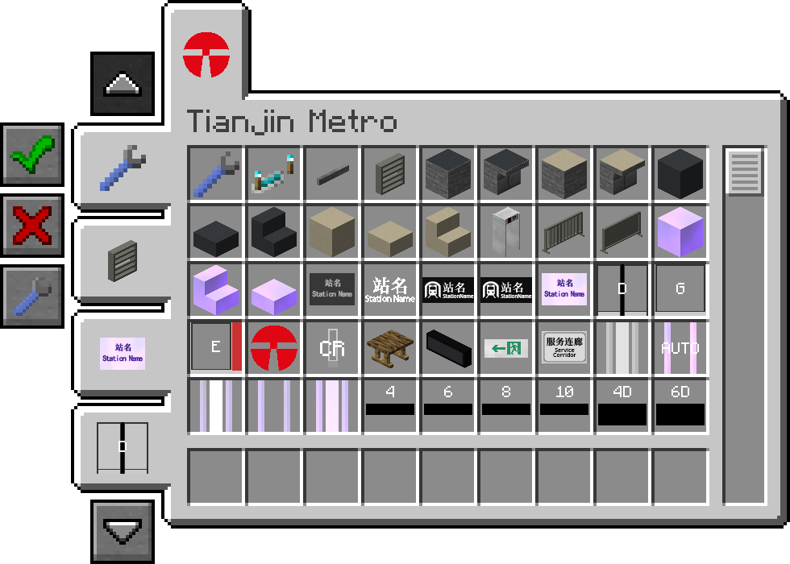

# Filters API

[简体中文](./README.md) · English

Filters API is an easy-to-use, open, complete library, that provides a filtering system to categorize your mod's creative tab.

Filters API makes it easy to find an item by adding new filter tabs to the left side of the creative screen that allow you to limit the items shown based on the category they fall under. Filters API also supports collecting uncategorized items to the uncategorized filter, to avoid uncategorized items disappearing from the tab.

Inspired by [Filters Mod](https://github.com/MrCrayfish/Filters) and [MrCrayfish's Furniture Mod](https://github.com/MrCrayfish/MrCrayfishFurnitureMod).

## What changed in the RongMC 26.3 port

The port adapts the creative inventory and SDL mouse input for 26.3 while keeping existing item categories. With RongMC Transport UI, transport-suite filter controls can follow the selected appearance.

## Installation

Download **v1.0.0-port.1+26.3** from [GitHub Releases](https://github.com/OpenRongMC/Filters-API/releases/tag/v1.0.0-port.1%2B26.3) for Minecraft Java **26.3** on **Fabric** with **Java 25**. Dependencies include [Fabric API](https://modrinth.com/mod/fabric-api). Place the release JAR in the instance’s `mods/` directory. Install it alongside the mods that use its filters, following their release-specific dependency requirements. In multiplayer, use the build selected by the modpack.
