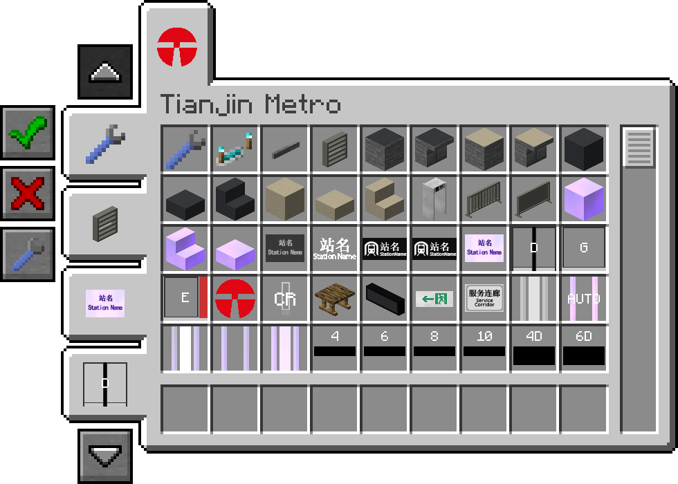

# Filters API

Filters API is an easy-to-use, open, complete library, that provides a filtering system to categorize your mod's creative tab.

Filters API makes it easy to find an item by adding new filter tabs to the left side of the creative screen that allow you to limit the items shown based on the category they fall under. Filters API also supports collecting uncategorized items to the uncategorized filter, to avoid uncategorized items disappearing from the tab.

Inspired by [Filters Mod](https://github.com/MrCrayfish/Filters) and [MrCrayfish's Furniture Mod](https://github.com/MrCrayfish/MrCrayfishFurnitureMod).

---

## RongMC · Minecraft 26.3 Fabric 移植说明

本仓库是 RongMC 维护的 **Minecraft 26.3 / Fabric / Java 25** 移植构建，不是上游官方发行渠道。

### 与原版的主要差异
- 移植到 Minecraft 26.3 Fabric，供 MTR 等创造模式物品栏筛选使用。
- Fabric id：`rongmc_filters`（provides `filters`）。

### 已知问题 / 限制
- 单独使用意义有限，通常作为交通套件依赖一起安装。
- 若与其它也改创造页签的模组叠用，筛选按钮布局可能互相挤压（上游同类问题）。

### 构建与安装
- Fabric mod id：`rongmc_filters`（`provides`：`filters`，旧依赖名一般仍可解析）
- Release 产物见本仓库 Releases（jar 名带 `rongmc-` 前缀）
- 许可证：本仓以 **GPL-3.0** 发布（见 `LICENSE`）；请同时尊重上游原作者条款与署名

